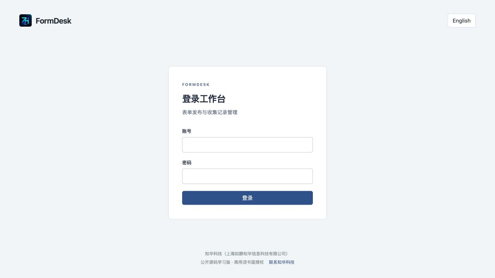
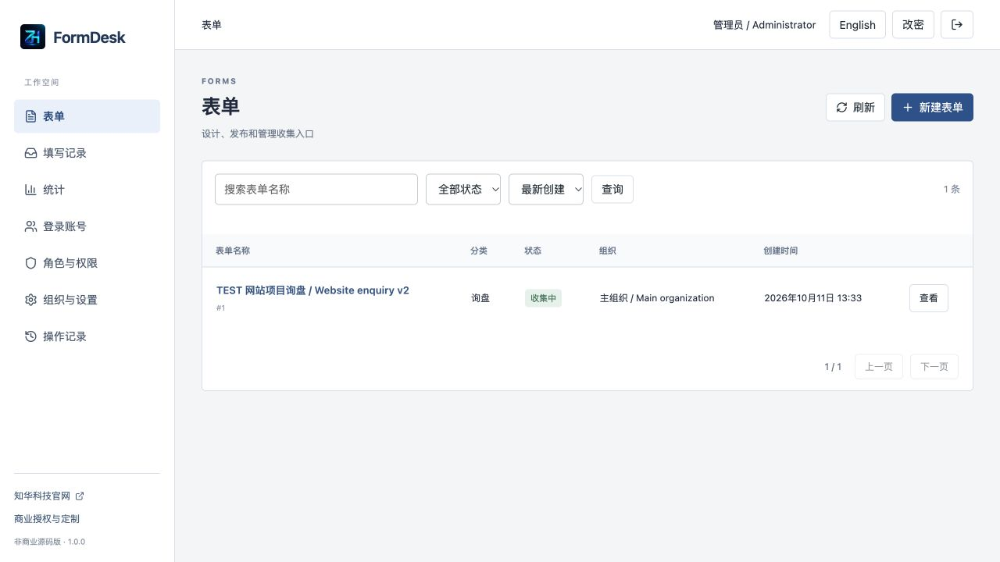
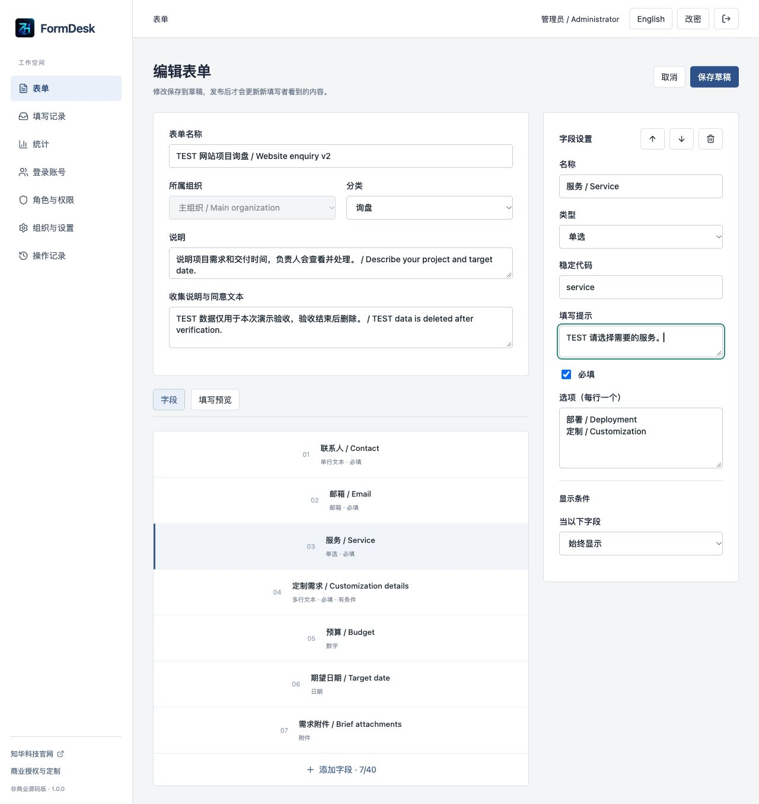
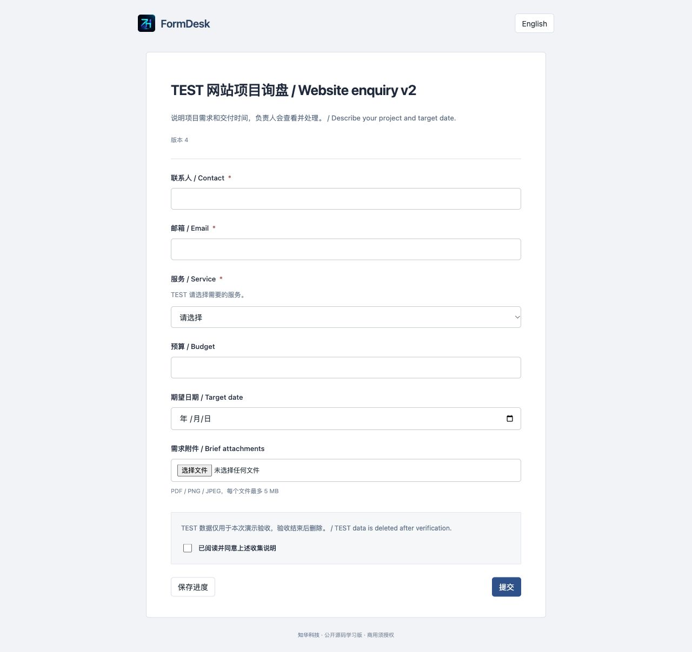
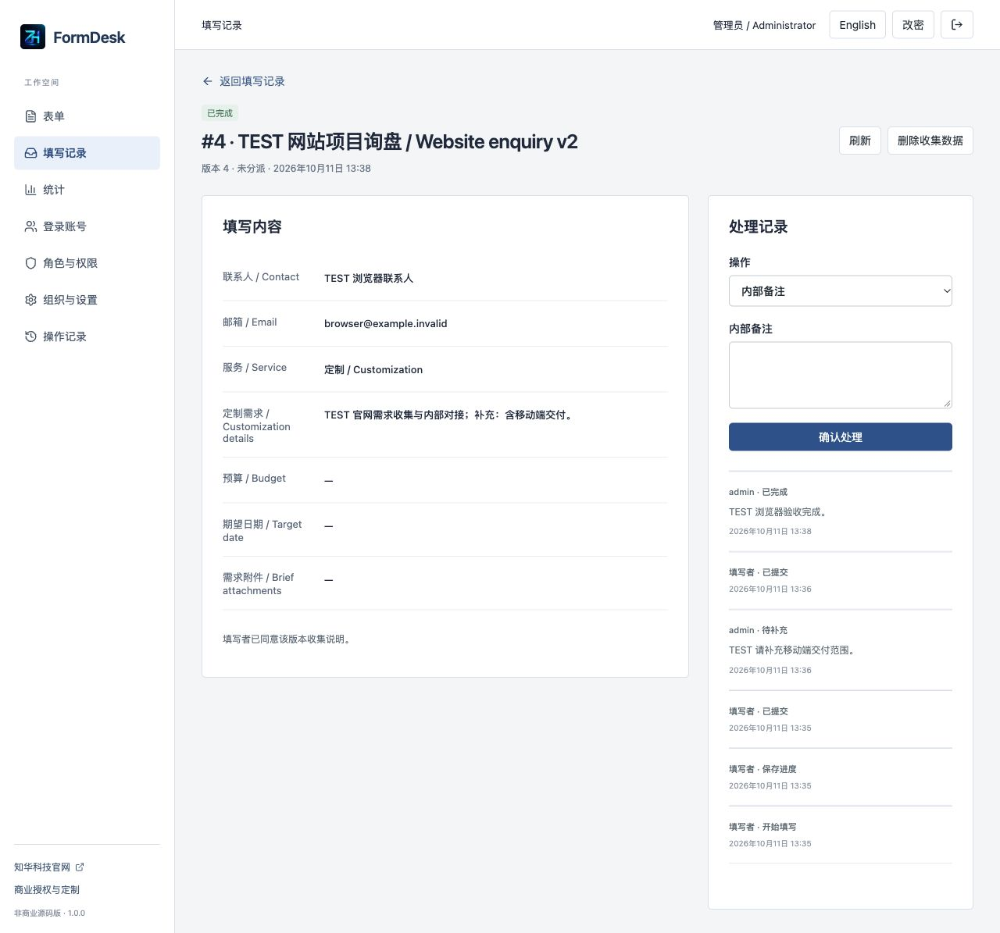
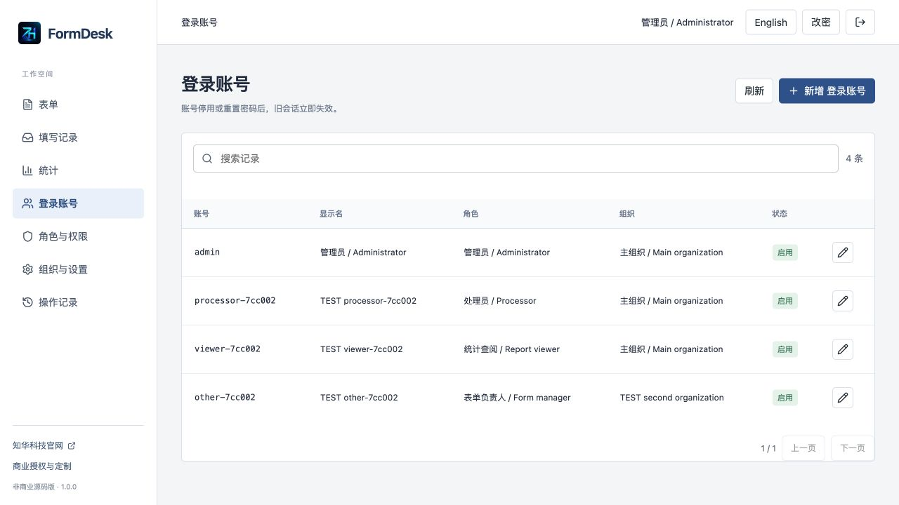
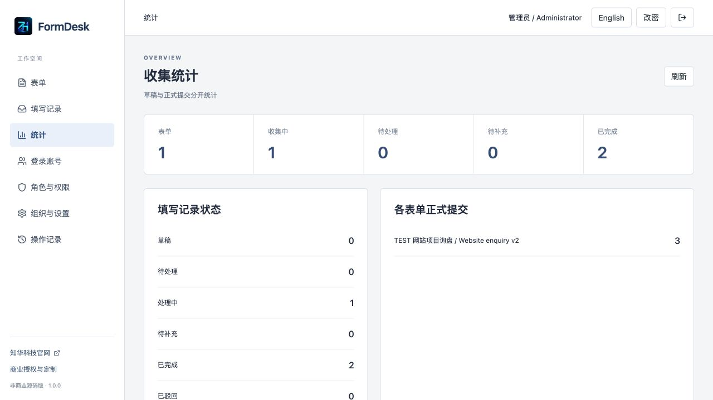
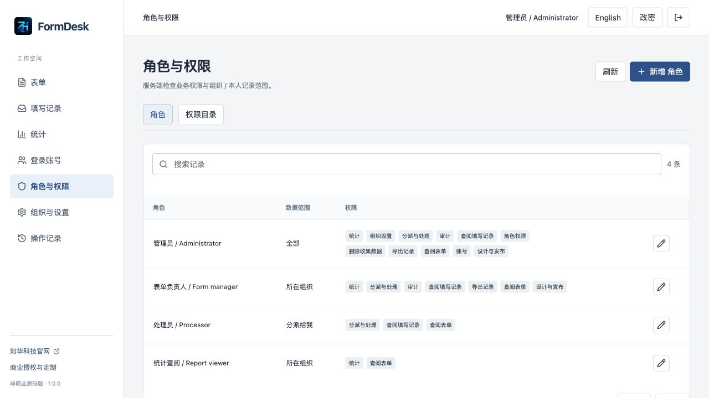
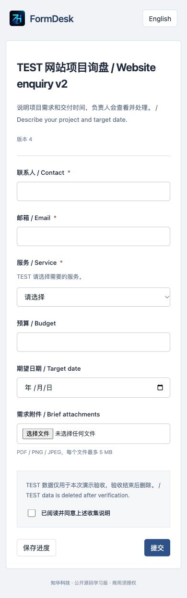
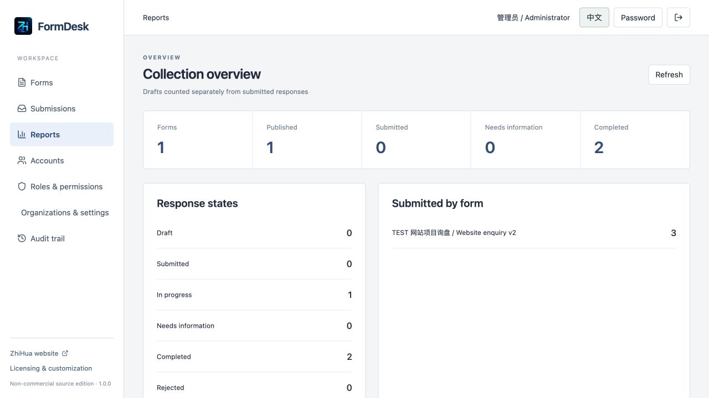

[中文](README.md) | [English](README.en.md)

# FormDesk — Self-hosted business forms and response processing · Java / Spring Boot / Vue / MySQL

**ZhiHua Technology (Shanghai Rujing Zhihua Information Technology Co., Ltd.)** · [Website](https://www.zhuatech.cn/)

FormDesk covers publishing a collection form, mobile responses, explicit progress saving, submission, assignment, requests for more information, completion and export. Intended scenarios include website project enquiries, applications/registration and project delivery information, including independent systems delivered by software implementation teams.

**Source-available learning edition, non-commercial use only.** Personal learning, research and non-commercial exchange are permitted. Commercial use requires written authorization from Shanghai Rujing Zhihua Information Technology Co., Ltd. This is not an OSI-approved open-source license or a free-commercial MIT/Apache license. See [LICENSE](LICENSE).

## Implemented workflows and users

| User | Implemented capabilities |
| --- | --- |
| Respondent, no account required | Link/QR response, conditional visibility, validation, files, explicit progress save, private receipt/resume, status review, supplement when requested |
| Form manager | Field design and preview, drafts, immutable publication/deadline, close/archive, response search, assignment, processing, internal notes and CSV |
| Assigned processor | Read/process assigned responses only; cannot reassign or read other responses |
| Administrator | Accounts/reset/disable/password change, custom roles, organization scope, menus, categories, response/file quotas, audit and explicit response purge |
| Report viewer | Form directory and actual aggregate statistics, without access to response answers |

Eight field types: short/long text, email, number, date, single/multiple choice and attachments. Conditions reference earlier unconditional single-choice fields. Limits: 40 fields/form, 30 choices/choice field. The server independently validates all input. Search, status filters, pagination, sorting and statistics use persistent records.

Saving a draft does not alter publication. Each publication creates an immutable snapshot; existing responses retain their revision. Submission locks editing until information is requested; supplement submission becomes In progress. Closing, expiry or organization disable blocks creation/saves/supplements. Existing receipts remain readable after close/expiry, but disabled organizations deny receipt access. Archive is irreversible. Purge removes response/files/internal events while retaining a content-free audit.

## Actual running screens

Screens contain TEST verification records from this application, not customer cases. Empty installation does not seed this business data or test accounts. Passwords, receipt secrets and actual customer information are excluded.

### 登录 / Login

私有管理账号会话登录。 / Private management session login.



### 表单工作台 / Forms workspace

真实数据库目录、分类、状态和查询。 / Persistent directory, category, state and search.



### 表单设计 / Form design

字段与发布草稿分开维护。 / Edit fields in an unpublished draft.



### 填写端 / Respondent page

无需账号，按发布版本显示及校验。 / Account-free response against a published revision.



### 处理详情 / Processing

查看答案、分派、补充要求和处理事件。 / Review answers, ownership, information requests and events.



### 后台账号 / Accounts

真实角色、组织、账号启停与重置。 / Roles, organizations, enablement and reset.



### 数据统计 / Statistics

草稿、正式提交及处理状态统计。 / Draft, submitted and processing counts.



### 权限设置 / Permissions

角色权限和ALL/组织/分派范围。 / Roles and ALL/organization/assigned scope.



### 手机填写 / Mobile form

响应式填写页面。 / Responsive respondent page.



### 英文工作台 / English workspace

界面切换，业务数据不翻译。 / UI language switching; business data stays unchanged.



## Architecture and source layout

Java21, Spring Boot4.0.7, Spring Security, JPA/Hibernate, Flyway; Vue3.5.43, Vite8.1.5, Lucide and qrcode; MySQL8.4, Nginx and Docker Compose. Same-origin Nginx proxies `/api`. The database persists forms, revisions, answers, events and binary attachments. BCrypt, HttpOnly/SameSite sessions, CSRF, live role/scope and record-version checks run on the server.

```text
backend/src/main/java/cn/zhuatech/formdesk/  # auth, administration, forms, responses
backend/src/main/resources/db/migration/   # V1 identity, V2 versioned collection
backend/src/test/java/                     # rule + HTTP/security/JPA tests
frontend/src/components/                  # designer, respondent and admin pages
frontend/public/brand/                    # official brand and original contact images
docs/screenshots/                         # actual running pages
scripts/                                  # environment, QA, release, backup/restore
compose.yaml                              # MySQL + Java backend + Nginx/Vue
.env.example                              # names only, no credentials
```

## Requirements and installation

Docker Engine/Desktop with Compose V2; at least4GB free memory recommended. Source development: JDK21, Maven3.9+, Node24.19.0+, npm and Python3.10+. Builds need access to official Maven/npm/Docker registries. Core workflows require no paid third-party service.

```sh
python3 scripts/init-env.py
docker compose -p formdesk config --quiet
docker compose -p formdesk up -d --build --wait --wait-timeout 240
```

Management: [http://127.0.0.1:8142/](http://127.0.0.1:8142/); health: [http://127.0.0.1:8142/actuator/health](http://127.0.0.1:8142/actuator/health). Initial username `admin`, password from the private local `.env` ADMIN_PASSWORD. No shared demo password. Initialization generates independent random credentials and refuses to overwrite `.env`; restart/environment changes do not reset existing users. For source development run Compose MySQL, inject backend environment variables, then run Maven backend and `npm run dev` frontend (Vite proxies8080).

## Database initialization and configuration

Flyway executes `V1__identity.sql`, then `V2__forms.sql`; Hibernate validates only.14 application tables plus Flyway history. Empty bootstrap creates one organization, admin,4 roles,11 permissions,7 menus,3 categories and2 parameters, without business samples. Database/attachments persist in mysql-data. Back up before upgrade; add migrations instead of modifying executed checksums.

| Variable | Purpose |
| --- | --- |
| MYSQL_ROOT_PASSWORD / DATABASE_PASSWORD | Required independent strong passwords; no weak defaults |
| ADMIN_USERNAME / ADMIN_PASSWORD | admin;12–72 bytes, uppercase/lowercase/digit; empty database only |
| WEB_PORT / BIND_ADDRESS | 8142 /127.0.0.1; configurable to avoid port conflicts |
| COOKIE_SECURE | false for local HTTP, true for HTTPS |
| DATABASE_URL / DATABASE_USER | Optional external MySQL with trusted CA, VERIFY_IDENTITY and migration DDL permissions |

See [.env.example](.env.example). Admin parameters set response quota/form including drafts (default1000, maximum10000), and files/response (default10, maximum20). Fixed file limit5MB; PDF/PNG/JPEG extension/signature validation, forced download, no malware scanning.

## Operations, deployment and security

Set up organizations/accounts, design fields and an accurate collection notice, save and publish, then share link/QR. Respondents retain private resume links after saving progress. Managers assign, request information, complete/reject and export CSV. See [User guide](docs/USER_GUIDE.md), [API and access](docs/API.md).

**A phone cannot reach another machine's127.0.0.1.** QR uses the management browser's current origin. LAN trials need reachable addresses; public deployment requires your own domain, HTTPS reverse proxy and secure cookies. No hosted public trial is included. See [Deployment, upgrades and backup](docs/DEPLOYMENT.md) for consistent backups and fresh isolated restore.

Receipt secrets stay in URL fragments, pass through dedicated headers and are stored only as hashes. Anyone holding a receipt link can access that response; lost links cannot be recovered anonymously. Never log answers or receipt headers. Private backups contain answers, password hashes and files; operators set retention. Organization scope is single-instance access control, not a hosted multi-tenant SaaS boundary. This is not a claim of production readiness.

## Tests, contribution and support

```sh
mvn -B -f backend/pom.xml spotless:check test package
cd frontend
npm ci --no-audit --no-fund
npm run format:check
npm run lint
npm test
npm run build
cd ..
python3 scripts/release-check.py
git diff --check
```

48 backend tests (17 rules +31 real HTTP/JPA/Flyway/Security),12 frontend tests. Fresh MySQL workflow, access, persistence and browser checks are described in [Testing](docs/TESTING.md). Docker Maven builds run all tests. Dedicated empty-database verification:

```sh
python3 scripts/quality.py --base http://127.0.0.1:8142
python3 scripts/verify-persistence.py --base http://127.0.0.1:8142
```

For login errors check the private password; refresh after version conflicts; check origin/network for QR access and state/deadline/quota/required fields for submission errors. See deployment troubleshooting. Report reproducible issues via repository Issues. Contributions must preserve branding, original-source license and third-party notices, include validation and exclude credentials/customer data. Disclose vulnerabilities privately through contacts below.

## Known limitations and unimplemented integrations

- Single-instance learning edition,10,000 rows/entity query ceiling, some in-memory filtering/statistics and serialized database writes. Large-scale/high-concurrency production capacity is not verified.
- No autosave, scheduled retention cleanup, email/SMS/WeChat notifications, verified respondent identity, bot CAPTCHA, SSO, payments, e-signatures, exam bank or AI.
- No completed CRM/ERP/Webhook integration, form-content translation, iframe embedding or object storage. Bilingual UI does not translate business data. Files are in MySQL; restore has a512MB uncompressed member cap and capacity must be planned.
- Signature checks are not malware scans; private receipts are not identity verification. Physical phone QR scanning, public-domain and cross-network deployment are not hardware-tested. Responsive mobile-width UI only; no native app.
- Core use needs no paid external credentials. Notifications/payments/CRM are unimplemented; commercial licensing does not mean these integrations are completed. Third-party licenses remain intact; see [Third-party notices](docs/THIRD_PARTY.md). Provided as-is, with disclaimer in LICENSE.

## 源码调试 / Source development

JDK 21 / Maven 3.9+ / Node 24.19+。使用开发覆盖文件只把数据库绑定到本机，不启动容器版后端/前端；backend 为8080、Vite默认5173，MySQL开发端口可通过MYSQL_DEV_PORT私有配置。 / Expose MySQL to localhost only with the development override; do not run container backend/frontend simultaneously. Backend listens8080, Vite5173; MYSQL_DEV_PORT defaults33142.

```sh
docker compose -p formdesk-dev -f compose.yaml -f compose.dev.yaml up -d mysql
python3 scripts/dev-backend.py
# Another terminal / 另一终端
cd frontend
npm ci --no-audit --no-fund
npm run dev
```

标准交付验收使用完整Compose；本机源码调试路径需要安装上述JDK/Maven，未另行验证本机Java运行时。 / Delivery verification uses full Compose; native source debugging requires the stated installed JDK/Maven and has not been separately verified on this host.

## Commercial authorization and contact

Personal learning/research/non-commercial exchange only; commercial delivery, deployment, source resale, SaaS and paid services require written authorization under [LICENSE](LICENSE). ZhiHua supports commercial source authorization, private deployment, enterprise digitalization, software development/implementation, systems integration and customization, including FDE/OPC support where applicable. These are service enquiries, not implemented product integrations.

**ZhiHua Technology (Shanghai Rujing Zhihua Information Technology Co., Ltd.)** · [https://www.zhuatech.cn/](https://www.zhuatech.cn/)

- Email: [han@zhuatech.cn](mailto:han@zhuatech.cn)
- Email: [jack@zhuatech.cn](mailto:jack@zhuatech.cn)
- WhatsApp: [+86 17521234993](https://wa.me/8617521234993)
